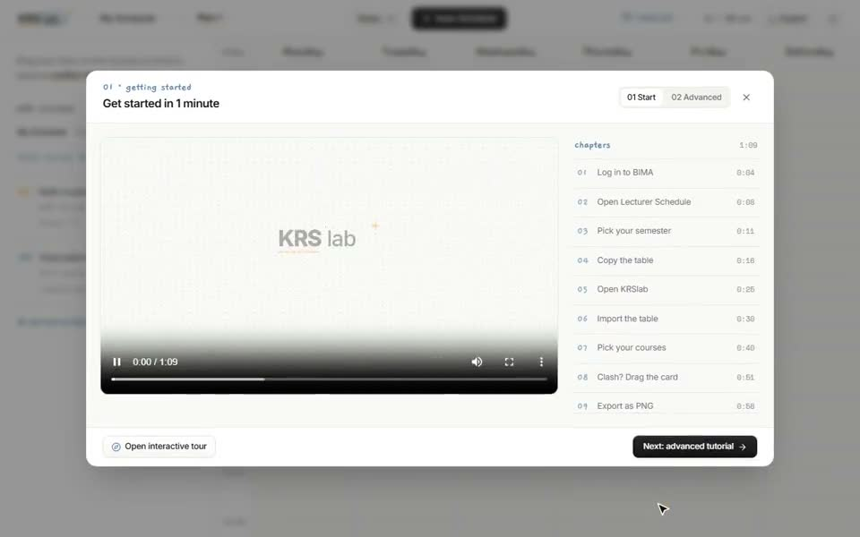

# KRSlab

[](https://github.com/glacerous/krslab/actions/workflows/ci.yml)
[](https://krslab.vercel.app)
[](./LICENSE)

An open-source (MIT) university schedule (**KRS**) planner built for Indonesian campus portals. Paste your course table from **BIMA**, **SIAKAD**, **SiakadCloud**, **SIMASTER**, **SIAK-NG**, **SIX**, or **SIAM**, resolve clashes automatically, drag-and-drop sections on a weekly grid, and share your schedule via a short link.



---

## Features

- **Conflict-Free Auto-Scheduler & Shuffle** — Generate valid timetable candidates instantly, lock preferred sections, and add custom scheduling rules (free days, time windows, max gap).
- **Interactive Drag & Drop** — Drag courses from the sidebar onto the grid, swap between parallel sections with live clash previews, or drag left to remove.
- **Universal Campus Parser** — Paste directly from BIMA, SIAKAD, Excel/CSV, or build custom courses manually.
- **Zero-DB Link Sharing & Transfer** — Share your schedule via a compressed `/view` link (with Open Graph preview cards) so friends can inspect and copy it into their own workspace, or export PNG, `.ics` calendar, and `.json` backups.
- **Bilingual & Responsive** — Indonesian (`ID`) and English (`EN`), light/dark mode, and mobile-friendly drawer layout.

---

## Tech Stack

- **Monorepo:** pnpm workspaces
- **Web:** Next.js 14 (App Router), React 18, Tailwind CSS, Zustand, Sonner
- **Engine:** `@krs/engine` (TypeScript parser, conflict detector, constraint solver)
- **Testing:** Vitest (engine) + Playwright (e2e)

---

## Getting Started

```bash
pnpm install
pnpm --filter @krs/engine build
pnpm --filter web dev
```

Open **http://localhost:3000** in your browser.

### Useful Scripts

```bash
pnpm -r exec tsc --noEmit   # Typecheck all packages
pnpm --filter @krs/engine test
pnpm --filter web lint
pnpm --filter web build
```

---

## Repository Structure

```text
apps/
  └── web              # Next.js studio, share viewer (/view), and UI
packages/
  └── engine           # Portal parser, conflict rules, and schedule solver
tools/                 # Media / asset utilities
```

---

## Contributing, Contact & Releases

KRSlab is open source! Issues and pull requests are welcome. See [`CONTRIBUTING.md`](./CONTRIBUTING.md) for local setup (including optional Upstash Redis for `/v/[id]` short links) and [`.github/ISSUE_TEMPLATE`](./.github/ISSUE_TEMPLATE) for bug reports.

- **Report a bug or reach out:** [@thefuturehold on X (Twitter)](https://x.com/thefuturehold) or [GitHub Issues](https://github.com/glacerous/krslab/issues)
- **Releases:** Automated via [`.github/workflows/release.yml`](./.github/workflows/release.yml) whenever a `v*.*.*` tag is pushed.

Licensed under [MIT](./LICENSE).
